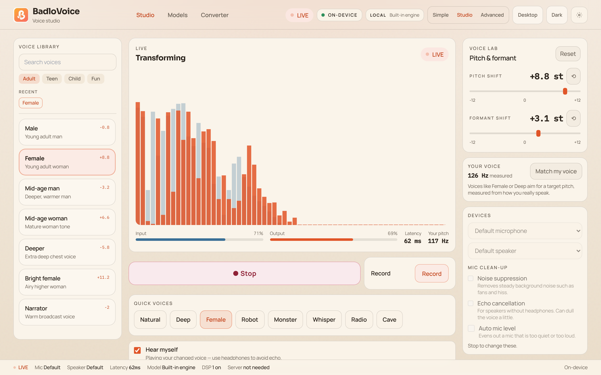
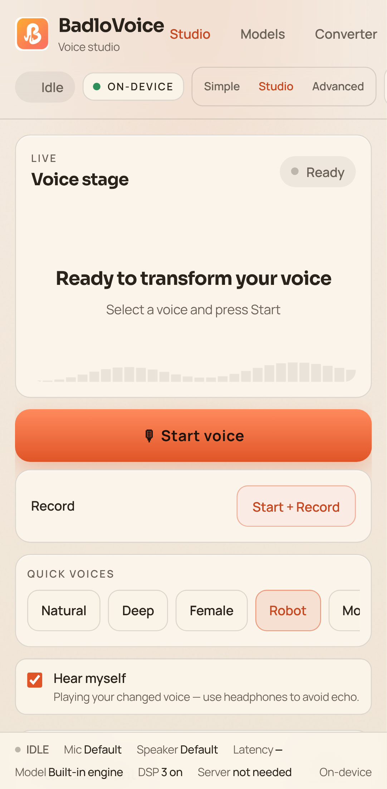

# BadloVoice

**Realtime voice changer for the browser and Android, with optional AI voice models.**

Change your voice live for Discord, games, streams or calls. The built-in engine runs on your device: no account, no upload, no server.

<p align="center">
  
</p>

<p align="center">
  <a href="#quick-start"><strong>Quick start</strong></a> ·
    <a href="#features">Features</a> ·
  <a href="#android-apk">Android</a> ·
  <a href="#send-your-voice-to-discord-obs-or-a-game">Discord / OBS</a> ·
  <a href="#contributing">Contribute</a>
</p>

<p align="center">
  <a href="https://github.com/abuzar310/badlovoice/stargazers"></a>
  <a href="https://github.com/abuzar310/badlovoice/network/members"></a>
  
  
  
  
</p>

<p align="center">
  
</p>

<p align="center">
  
</p>

---

## Features

| Area | What you get |
|------|--------------|
| **Built-in voice engine** | Pitch and formant move independently, so a higher voice keeps a natural tone unless you ask for a chipmunk. Runs in the browser with about 22 ms of added latency. |
| **24 voices** | Adult, teen, child and effect voices: Robot, Whisper, Monster, Alien, Cave and more. Voices that target a pitch aim from your own speaking pitch, which the app measures while you talk. |
| **Effects rack** | Noise gate, robot, monotone, vibrato, whisper, telephone, distortion, bitcrush, chorus, echo, reverb, tone EQ, compressor, output gain. |
| **Record** | Capture the changed voice and download it as WAV. |
| **Convert a file** | Drop in a WAV, MP3, M4A, OGG or FLAC and get it back in the voice you set up. The file stays on your device. |
| **Send to another app** | Choose a virtual cable as the output and Discord, OBS or a game hears the changed voice. |
| **AI voice models (optional)** | Run the Python backend to load RVC (`.pth`) or ONNX models, with model slots, F0 methods (PM, Harvest, Crepe, RMVPE, FCPE), index and protect controls. |
| **Android** | The same UI packaged as an APK with Capacitor. |

---

## Quick start

### Voice changer only (no Python)

You need Node.js 20 or newer.

```bash
git clone https://github.com/abuzar310/badlovoice.git
```

```bash
cd badlovoice/frontend
```

```bash
npm install
```

```bash
npm run dev
```

Open **http://127.0.0.1:5173**, press **Start voice**, allow the microphone and pick a voice. Put on headphones and tick **Hear myself** to listen. Without headphones the speakers feed back into the mic.

### Add AI voice models (optional)

You need Python 3.10 or 3.11 (the AI packages pin versions that have no builds for newer Python). An NVIDIA GPU with CUDA makes RVC and ONNX models faster.

```powershell
python -m venv .venv
.\.venv\Scripts\Activate.ps1          # macOS/Linux: source .venv/bin/activate
pip install -r backend/requirements.txt
```

Terminal A, the backend:

```powershell
python -m uvicorn backend.main:app --host 127.0.0.1 --port 8000
```

Terminal B, the UI:

```powershell
cd frontend
npm run dev
```

Load a model on the **Models** tab and activate it. While a model is active the server produces the voice; with no model the browser engine does. See [docs/MODELS.md](docs/MODELS.md) for where models come from and what RVC needs (HuBERT at `models/assets/hubert_base.pt`, plus the RVC package):

```powershell
pip install --no-deps git+https://github.com/RVC-Project/Retrieval-based-Voice-Conversion
```

### One process (UI served by FastAPI)

```powershell
cd frontend
npm install
npm run build
cd ..
python -m uvicorn backend.main:app --host 127.0.0.1 --port 8000
```

Open http://127.0.0.1:8000

---

## Send your voice to Discord, OBS or a game

Apps can only listen to a microphone, so the changed voice has to arrive on something that looks like one. A virtual audio cable does that.

1. Install a virtual cable: [VAC](https://software.muzychenko.net/freeware/vac470lite.zip) or VB-Cable.
2. In BadloVoice switch to **Studio** or **Advanced** view. Under **Devices** keep your real mic as the microphone and choose the cable (for example "Line 1") as the speaker.
3. Press **Start voice**. The changed voice goes to the cable straight away.
4. In Discord, OBS or the game, choose the same cable as the microphone.
5. Tick **Hear myself** if you also want a copy on your own headphones.

Choosing an output device needs a Chromium browser (Chrome or Edge). Set the mic and the cable to 48000 Hz where you can.

With a GPU machine elsewhere on your network: run the backend there and open the UI from your gaming PC.

---

## Android APK

Build a debug APK (Android SDK and Gradle required):

```powershell
cd frontend
npm run apk
```

Output: `frontend/android/app/build/outputs/apk/debug/`

iOS needs a Mac and Xcode (`npm run mobile:sync:ios`).

---

## How it works

```text
Microphone
   │
   ▼
Noise gate ──► Built-in engine (AudioWorklet, on your device)
   │              pitch + formant shifter ─► effects rack ─► limiter
   │                                                          │
   │   only while an AI model is active                       ▼
   └──► FastAPI /ws/audio ─► RVC / ONNX model ─► effects ─► output bus
                                                              │
                                    speakers or virtual cable ┤
                                    recorder (WAV)            ┘
```

Exactly one source feeds the output bus at a time: the browser engine, or the server model when one is active.

| Path | Role |
|------|------|
| `frontend/public/voiceEngineCore.js` | The voice engine: pitch tracker, pitch and formant shifter, effects. Plain JavaScript, no dependencies. |
| `frontend/public/*Worklet.js` | AudioWorklet wrappers: engine, noise gate, server capture and playback |
| `frontend/src/` | React UI |
| `frontend/android/` | Capacitor Android project |
| `mobile/` | Expo wrapper around the hosted site |
| `backend/` | FastAPI: WebSocket audio, models, slots, presets, the same effects in Python |
| `models/` | Your checkpoints and `assets/` (HuBERT, RMVPE) |
| `data/` | Runtime presets, slots and profiles (not tracked) |

---

## Tests

The engine has a test suite that runs in Node with no browser:

```bash
cd frontend
```

```bash
npm test
```

Backend tests (Python, no GPU or AI packages needed):

```bash
pip install -r backend/requirements-dev.txt
```

```bash
npm run test:backend
```

The engine suite checks pitch accuracy across voices and sample rates, that formants stay put when only pitch moves, that the original pitch does not leak through on speech-like input, every effect for stability, and that the whole rack runs well above realtime.

---

## Configuration

Environment prefix: `SHIFTBOOTH_` (legacy name; still used in code).

| Variable | Default | Notes |
|----------|---------|--------|
| `SHIFTBOOTH_HOST` | `127.0.0.1` | Bind address for `python -m backend.main`. Use `0.0.0.0` only on a network you trust: the API has no login. |
| `SHIFTBOOTH_CORS_ORIGINS` | `[]` | Extra web origins allowed to call the API (JSON list). Other sites get 403. |
| `SHIFTBOOTH_PORT` | `8000` | HTTP + WS port |
| `SHIFTBOOTH_MODELS_DIR` | `models` | Checkpoint directory |
| `SHIFTBOOTH_SAMPLE_RATE` | `40000` | Stream default |
| `SHIFTBOOTH_CHUNK_SIZE` | `4096` | Overridden by latency modes in the UI |
| `SHIFTBOOTH_HUBERT_PATH` | `models/assets/hubert_base.pt` | RVC content encoder |
| `SHIFTBOOTH_DEFAULT_LATENCY_MODE` | `balanced` | `ultra` / `balanced` / `quality` |

See `backend/config.py` for the full list.

---

## Project scripts

Run these from the repository root:

```powershell
npm run dev       # frontend dev server
npm run build     # frontend production build
npm run server    # backend on 127.0.0.1:8000
```

Drive upload helper (optional). It needs your own OAuth client; never commit the credentials:

```powershell
.\.venv\Scripts\python.exe scripts\upload_apk_to_drive.py path\to\app.apk
```

---

## Star the repo

If BadloVoice helps you, **star the repo**. Stars help other people find a local, open voice changer.

[](https://star-history.com/#abuzar310/badlovoice&Date)

---

## License

MIT. See [LICENSE](LICENSE).

Upstream OpenVoiceChanger is MIT (Sioaeko). Other projects contributed design patterns; see [ATTRIBUTION.md](ATTRIBUTION.md).

## Attribution

| Project | Contribution |
|---------|----------------|
| [OpenVoiceChanger](https://github.com/sioaeko/OpenVoiceChanger) | Primary web stack: FastAPI, binary WS, AudioWorklet, DSP rack, RVC/ONNX |
| [w-okada/voice-changer](https://github.com/w-okada/voice-changer) | Model slots, crossfade/buffer, remote client idea |
| [Vonovox](https://github.com/dr87/Vonovox) | VAD/noise-gate assist, VAC guidance |
| [echidna](https://github.com/supermarsx/echidna) | Latency modes, settings profiles |

## Contributing

Issues and pull requests are welcome. See [CONTRIBUTING.md](CONTRIBUTING.md).

Good first areas: new voices and effects, phone layout, docs, Android packaging, install scripts for macOS and Linux.
